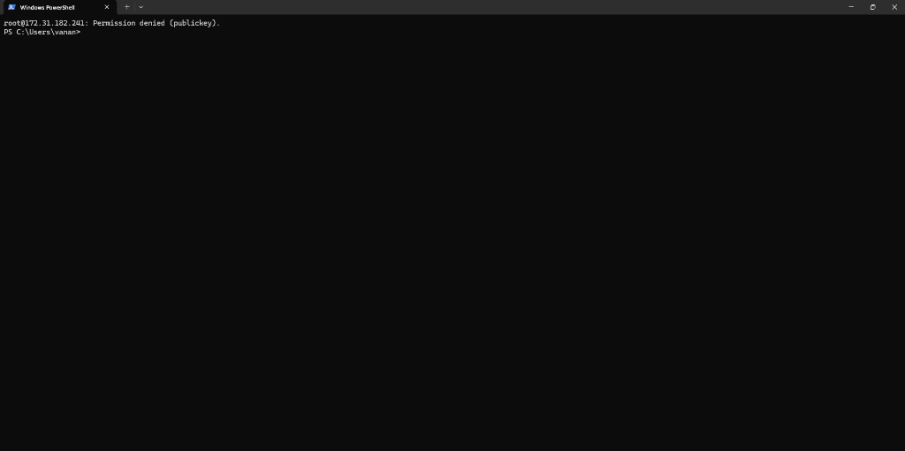

# Bài tập 3: Tăng cường bảo mật SSH

## 1. Các tệp cấu hình & Hướng dẫn
- [`commands.txt`](./commands.txt): Trọn bộ lệnh tạo SSH Key `Ed25519`, đẩy Public Key lên `/home/deploy/.ssh/authorized_keys`, cấu hình `/etc/ssh/sshd_config` (`PermitRootLogin no`, `PasswordAuthentication no`) và kiểm chứng từ chối `root`.
- [`harden-ssh.sh`](./harden-ssh.sh): Script kiểm tra an toàn và cấu hình bảo mật OpenSSH.

## 2. Ảnh minh chứng kết quả (`ssh root` bị từ chối)

